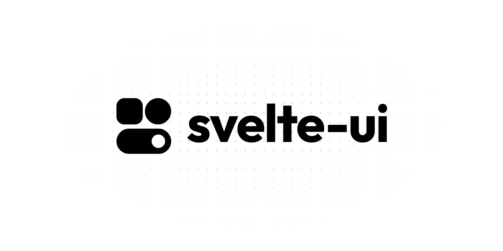

# svelte-ui

A minimal, monochrome component library for Svelte 5, built with runes, TypeScript and plain CSS custom properties.

```sh
npm install @noahbaumgartner/svelte-ui
```

## Usage

Import the design tokens once, at the root of your app (e.g. `src/routes/+layout.svelte`):

```svelte
<script lang="ts">
	import '@noahbaumgartner/svelte-ui/tokens.css';

	let { children } = $props();
</script>

{@render children()}
```

Then use the components:

```svelte
<script lang="ts">
	import { Button, Card, CardHeader, CardTitle, CardContent } from '@noahbaumgartner/svelte-ui';
	import { Plus } from '@lucide/svelte';
</script>

<Card>
	<CardHeader>
		<CardTitle>Projects</CardTitle>
	</CardHeader>
	<CardContent>
		<Button icon={Plus} variant="primary">New project</Button>
	</CardContent>
</Card>
```

### Icons

The library ships no icons and works with any icon library. Every `icon` prop takes a Svelte component, so use [Lucide](https://lucide.dev), [Phosphor](https://phosphoricons.com), your own SVG components or anything else:

```svelte
<script>
	import { Button } from '@noahbaumgartner/svelte-ui';
	import Plus from '@lucide/svelte/icons/plus';
</script>

<Button icon={Plus}>New project</Button>
```

An icon component receives `class` and `aria-hidden` and is sized with CSS, so it should render a single `<svg>` that fills its box. The `IconComponent` type describes what the props accept.

### Theming

Set the variables below on `:root` in your app; every one is optional. All colours are derived from two of them, `--ui-base` (page) and `--ui-ink` (text), mixed into a grey scale.

| Variable                                    | Default              | Used for                                             |
| ------------------------------------------- | -------------------- | ---------------------------------------------------- |
| `--ui-base`, `--ui-base-dark`               | `#fff`, `#0a0a0a`    | Page colour in light and dark mode                   |
| `--ui-ink`, `--ui-ink-dark`                 | `#000`, `#fff`       | Text colour in light and dark mode                   |
| `--ui-accent`, `--ui-accent-dark`           | `--ui-ink`           | Checked controls, primary buttons and focus rings    |
| `--ui-fill`, `--ui-fill-dark`               | 3% ink on base       | Cards and empty states (e.g. white on a tinted page) |
| `--ui-destructive`, `--ui-destructive-dark` | `#dc2626`, `#f87171` | Errors and destructive actions                       |
| `--ui-font-sans`                            | the system font      | All text (`--font-sans`, set on `:root`)             |
| `--ui-font-display`                         | `--ui-font-sans`     | Page titles, the `Navbar` logo (`--font-display`)    |

The `-dark` variants are only used in dark mode and fall back to the defaults above (the accent falls back to `--ui-accent`). So a custom palette keeps working in dark mode, and you only set the dark values you want to change:

```css
:root {
	--ui-base: #f6f3ee;
	--ui-ink: #1c1d26;
	--ui-base-dark: #14120f;
	--ui-accent: #2563eb;
	--ui-accent-dark: #60a5fa;
	--ui-font-sans: 'Space Grotesk Variable', system-ui, sans-serif;
	--ui-font-display: 'Bricolage Grotesque Variable', system-ui, sans-serif;
}
```

Light and dark mode follow `prefers-color-scheme` by default; force one with a `data-theme` attribute on `<html>`:

```html
<html data-theme="dark"></html>
```

In your own CSS, read the resolved tokens (`--color-base`, `--color-ink`, `--color-text`, `--color-surface`, `--color-accent`, `--font-display`, ...) rather than the `--ui-*` inputs: they switch with the theme. The foreground colour on top of the accent is picked automatically for contrast.

Two limits to know about:

- Set the variables on `:root`. The derived colours are computed there, so setting `--ui-accent` on a single element does not recolour what is inside it.
- Corner radii are internal for now: the components use the `--radius-*` scale from `tokens.css`, which is not meant to be configured yet.

### Page defaults

`base.css` is optional. It adds a small reset, the page colours and the layout tokens that `Section`, `PageHeader` and `ActionBar` read. Import it after the tokens:

```svelte
<script lang="ts">
	import '@noahbaumgartner/svelte-ui/tokens.css';
	import '@noahbaumgartner/svelte-ui/base.css';
</script>
```

| Variable              | Default                 | Used for                                            |
| --------------------- | ----------------------- | --------------------------------------------------- |
| `--content-max-width` | `1376px`                | Width of the page content, between the gutters      |
| `--section-max-width` | `--content-max-width`   | What `Section`, `PageHeader` and `ActionBar` follow |
| `--gutter`            | `16px`, `24px` from 640 | Side padding of `ActionBar`                         |

It lives in a sub-layer of `svelte-ui`, so components win over the reset and any unlayered rule of your app wins over both. It also adds a `.visually-hidden` class.

## Components

| Category   | Components                                                                                                                                 |
| ---------- | ------------------------------------------------------------------------------------------------------------------------------------------ |
| Actions    | `Button`, `ButtonGroup`, `Toggle`, `Link`                                                                                                  |
| Forms      | `Input`, `InputGroup`, `FileInput`, `Textarea`, `Select`, `NumberStepper`, `Checkbox`, `RadioGroup`, `Switch`, `Label`, `Field` family     |
| Pickers    | `Calendar`, `TimePicker`, `ColorPicker`                                                                                                    |
| Overlays   | `Dialog`, `AlertDialog`, `Drawer`, `Popover`, `Tooltip`, `ContextMenu`, `Toaster` + `toast()`                                              |
| Navigation | `Navbar`, `NavigationMenu`, `Sidebar` family, `Breadcrumb`, `Tabs`                                                                         |
| Display    | `Card` family, `Table`, `Accordion`, `Avatar`, `AvatarGroup`, `Badge`, `EmptyState`, `Kbd`, `Progress`, `Separator`, `Skeleton`, `Spinner` |

Every component is documented in Storybook, with one story per prop.

## Development

```sh
npm install
npm run storybook   # component workbench on http://localhost:6006
```

| Script              | Description                                      |
| ------------------- | ------------------------------------------------ |
| `npm run storybook` | Start Storybook                                  |
| `npm run check`     | Type-check with `svelte-check`                   |
| `npm run test`      | Run unit and Storybook tests with Vitest         |
| `npm run lint`      | Check formatting (Prettier) and lint (ESLint)    |
| `npm run format`    | Format all files                                 |
| `npm run build`     | Build the package into `dist/` and run `publint` |

Components live in `src/lib/components/<name>/`, each next to its `.stories.svelte` file, and are exported from [`src/lib/index.ts`](src/lib/index.ts).

## Releasing

Publishing a GitHub release triggers [`.github/workflows/publish.yml`](.github/workflows/publish.yml), which sets the package version from the release tag (e.g. `v0.2.0` → `0.2.0`), type-checks, and stages the publish on npm with provenance. The staged version then has to be approved with 2FA (`npm stage approve <stage-id>` or on npmjs.com).

## License

[MIT](LICENSE)
